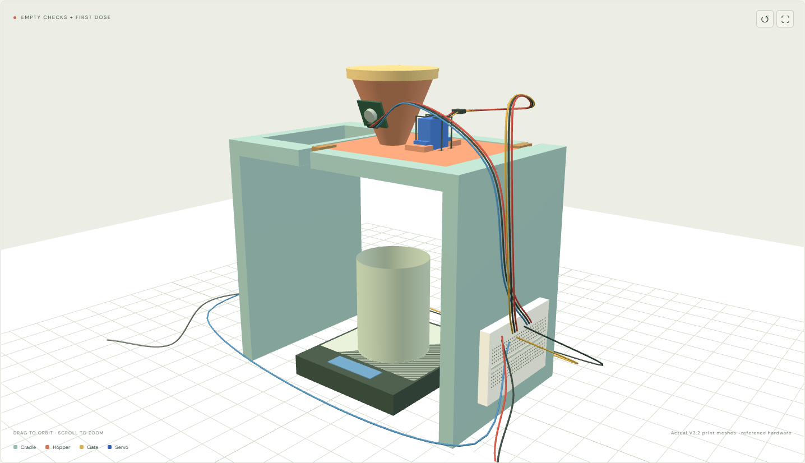

# Flour / V3.2 — current assembly, retained stand and locking clips

**[Complete V3.2 assembly guide](public/hardware/BUILD_GUIDE_V3_2.html)** · [Current captioned video](public/flour-v3-2-assembly.webm) · [Live step-by-step animation](https://dylanler.github.io/flour-dispenser-assembly/)

**[Every wire, end to end](https://dylanler.github.io/flour-dispenser-assembly/hardware/wiring/WIRING_GUIDE.html)** — numbered W01–W11 walkthrough, exact breadboard holes, connector ends and power-up sequence. This defined map uses four five-hole strips; long rails are unused. Module IN remains conditional on the actual input circuit.

> **Current repair: V3.2, original servo height.** [Download the repair plate](public/hardware/servo-fit/V3_2_REPAIR_PLATE_HOPPER_GATE_PACKING.3mf) and follow the [assembly guide](public/hardware/servo-fit/REPAIR_GUIDE.html). Replace the hopper and gate only; keep the stand, lid and clips. A local case recess replaces the earlier servo raise. The gate accepts larger horns and includes optional packing so the supplied horn seats fully first. One PETG plate: **86.64 g / about 3 h 22 min**. Best-effort prototype, physically untested; exact horn seating remains an assumption accommodated over a finite adjustment range. Original V3 and V3.1 files are superseded for this repair.

A flour dispenser prototype with a wide, open-front stand, SG90 rotary gate, **5V PWM vibration module (9000 RPM)**, USB-C ESP32 and MicroPython control. **Two removable printed snap-lock clips replace the V2 retaining bands.** No additional purchased latches or frame screws are required for hopper retention.

**[V3.2 fit simulation](https://dylanler.github.io/flour-dispenser-assembly/fit-check.html)** · **[Interactive assembly film](https://dylanler.github.io/flour-dispenser-assembly/)** · [V3.2 repair plate](public/hardware/servo-fit/V3_2_REPAIR_PLATE_HOPPER_GATE_PACKING.3mf) · [V3 build guide](public/hardware/BUILD_GUIDE_V3.html) · [Mac/Python setup](docs/SOFTWARE.md) · [Parts](docs/PARTS.md)



| Dimension | V3 design |
|---|---|
| Stand footprint and height | 224 × 140 × 190 mm |
| Clear width between side walls | 200 mm |
| Scale from the supplied image | 105 mm wide × 125 mm deep × 17 mm high; 500 g maximum |
| Nominal gate underside above table | 178.3 mm with V3.2 gate |
| Conservative space below screw/hardware | About 173 mm with V3.2; measure the real assembly |
| Example collection cup | Ø60 × 80 mm, **assumed**, not specified by the user |
| Print plate | All six pieces on one A1 plate |

The scale rests on the table inside the opening and does not touch the stand. The robot collects the **cup under the dispenser**, not the hopper. Keep the front approach clear. Space is provided for fingers around the example cup; actual YAM/SO-101 reach, wrist, gripper and cup compatibility are **not validated**. See [scale and robot clearance](docs/ROBOT_CLEARANCE.md).

## Current V3.2 assembly

1. Retain the stand, lid and both printed locking clips. Use the V3.2 hopper/gate and included optional aids.
2. Insert and tie the servo in the local case pocket at its original support height. No added servo-ear shims. Attach the motor module unpowered.
3. Mount the ESP32 and 400-point breadboard separately on the outside walls. Wire and check W01–W08; leave motor VCC/IN off during servo-only tests.
4. Install MicroPython and center the bare servo. Unplug, fully seat the supplied horn on the shaft and secure its centre screw.
5. Lift the new gate around the seated horn. Start without packing. Add only needed packing below the horn arms for 0.4–0.8 mm clearance, then secure through the gate grooves. The 0.6 mm strip is a reference aid, not a pass/fail gauge for every valid gap.
6. Seat the head, refit both clips, secure cables, and add W09–W11 only after module input verification. Calibrate empty before flour.

A1 / 0.4 mm, matching PETG preset, 0.20 mm layers, 3 walls, 5 top/bottom layers, **15% gyroid, supports off**. The earlier 86.64 g / 3 h 22 min reference was sliced at 20%; the 15% estimate will differ. Original V3/V3.1 assets remain for history and audit, not for this repair. No print geometry changed in this instruction update.

## Power and Python

**5V USB-A brick → four-terminal USB-A male screw-terminal adapter → two jumper leads → breadboard buses → servo + vibration module.** The **MacBook USB-C cable powers/programs the ESP32** separately. Grounds are common. Use only the adapter terminals marked +5V / VCC / VBUS and GND / −; leave D+ and D− empty. No cable cutting, splicing or soldering is needed for this power connection. Match the real terminal markings; the illustrated terminal order is not a verified pin map. The brick lies on its side in the animation, its USB port facing the adapter, with wires leaving the far green block.


**GPIO18 → servo signal; GPIO19 → vibration module IN**, conditional on verifying that the actual module accepts 3.3V control with its 5V supply. Do not connect external +5V to ESP32 GPIOs, 3V3 or USB power. See [wiring](docs/WIRING.md) and [motor research](docs/RESEARCH.md).

Follow [Mac/Python setup](docs/SOFTWARE.md). No Arduino IDE is needed. Firmware starts disarmed with vibration disabled. Apply measured servo calibration after each reboot; enable the motor only after input verification. Doses are limited to 5 seconds, arming expires after 60 seconds, and a 50 ms full-duty startup pulse precedes a positive requested motor duty. Stop closes/disarms and turns vibration off. The scale has **no electronic connection** to this controller: dosing is timed, not controlled by weight. Stop vibration and wait for the reading to settle before weighing.

## Animation and checks

Node.js 22.12+:

```sh
npm ci
npm run dev
```

The main animation and full guide use actual V3.2 hopper/gate/packing meshes and the source-labelled SG90/horn reference. Horn seating precedes gate installation. Wiring stages show numbered SVG maps. Video export includes the maps and captions; the current hosted file is `flour-v3-2-assembly.webm`, a 2× overview. Use the live player at 1× or the written steps for slower assembly. Actual horn dimensions and physical performance remain unverified. Earlier V3 videos are historical and are not promoted.

```sh
npm test
python -m unittest discover -s tests -p "test_*.py"
npm run build
```

[Validation details](docs/VALIDATION.md) distinguish software, mesh and slicer checks from physical performance. `public/hardware/source/regenerate_v3.py` regenerates V3 CAD; its dependencies are listed beside it. V2 files remain explicitly named as V2 for users of the previous print. The original V3 plate still contains the faulty hopper/gate: use the separately named V3.2 repair plate for this repair.

**Not physically tested:** clip flex/insertion/retention, servo fit, supply performance, flour bridging, flow and leakage, or robot pickup. The gate has clearance, is not sealed and does not mechanically close on loss of power. Use supervised small flour trials. Printed food-contact surfaces need your own material/cleanability assessment; this is not certified food equipment or a metallic-powder design.

Wi-Fi control is implemented. USB-C supports programming/REPL; Bluetooth and a separate continuous USB control protocol are not implemented. Public prototype AP defaults are `FlourProto` / `FlourTest26`; change them in `firmware/main.py` for shared environments. MIT license; no vendor affiliation.


## V3.2 fit simulation and current precision target

`fit-check.html` loads the actual V3.2 printed meshes, source-labelled SG90 reference geometry, an editable assumed horn/socket, optional packing, routed ties, clips, stand/lid, scale/example cup and illustrative electronics. Inspect whole assembly, underside, open half-section, x-ray and explosion. Move the gate through +/-70 degrees. The precomputed default audit found no unintended overlap in 1197 pair checks across 29 positions. Socket assumptions are editable and negative clearance/bottoming states are flagged; arbitrary parameter changes use analytic checks, not a new mesh audit. No physical fit claim is made.

Generate its reference hardware and numerical report with `python scripts/build_fit_simulation.py`. The print STLs are unchanged. The socket is a smooth-bore approximation (not real teeth/threads); its default OD, depth, mouth gap and axial position are assumptions.

Current user target is **larger doses with +/-10 mg**, superseding +/-1 mg. Servo position/aperture area is not a mass calibration. See the [accuracy assessment](public/hardware/simulation/MILLIGRAM_ACCURACY.html): measure repeatability, characterize fine pulses and settling, and add balance feedback for automatic correction. The current pocket scale is unconnected and its displayed resolution does not validate accuracy. No simulated powder dynamics or accuracy claim.

[Overview](public/hardware/simulation/overview.png) · [Servo section](public/hardware/simulation/section.png) · [Numerical report](public/hardware/simulation/assembly_collision_report.json). Three known-bad fits were detected as negative controls.
