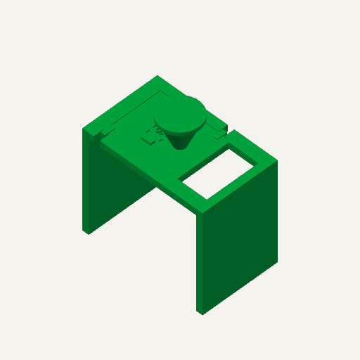
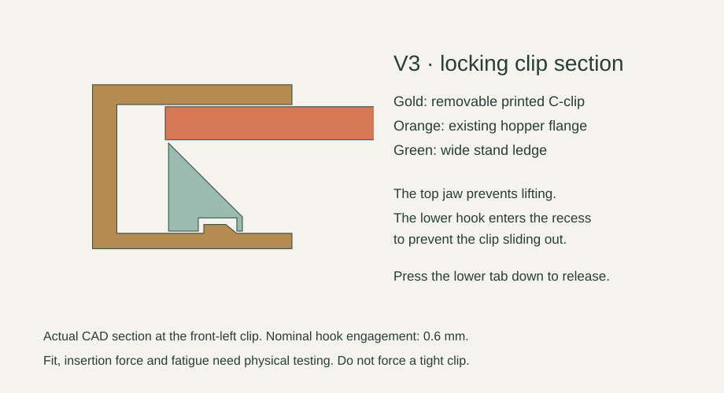
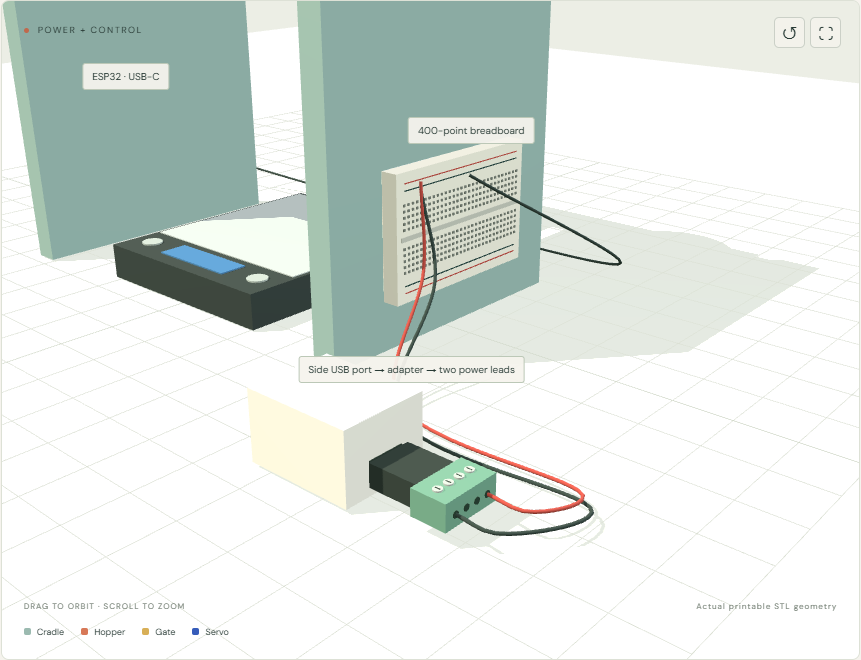

# Flour / V3 — wide scale bay, printed locking clips

> **Current repair: V3.2, original servo height.** [Download the repair plate](public/hardware/servo-fit/V3_2_REPAIR_PLATE_HOPPER_GATE_PACKING.3mf) and follow the [assembly guide](public/hardware/servo-fit/REPAIR_GUIDE.html). Replace the hopper and gate only; keep the stand, lid and clips. A local case recess replaces the earlier servo raise. The gate accepts larger horns and includes optional packing so the supplied horn seats fully first. One PETG plate: **86.64 g / about 3 h 22 min**. Best-effort prototype, physically untested; exact horn seating remains an assumption accommodated over a finite adjustment range. Original V3 and V3.1 files are superseded for this repair.

A flour dispenser prototype with a wide, open-front stand, SG90 rotary gate, **5V PWM vibration module (9000 RPM)**, USB-C ESP32 and MicroPython control. **Two removable printed snap-lock clips replace the V2 retaining bands.** No additional purchased latches or frame screws are required for hopper retention.

**[Interactive assembly film](https://dylanler.github.io/flour-dispenser-assembly/)** · [V3.2 repair plate](public/hardware/servo-fit/V3_2_REPAIR_PLATE_HOPPER_GATE_PACKING.3mf) · [V3 build guide](public/hardware/BUILD_GUIDE_V3.html) · [Mac/Python setup](docs/SOFTWARE.md) · [Parts](docs/PARTS.md)



| Dimension | V3 design |
|---|---|
| Stand footprint and height | 224 × 140 × 190 mm |
| Clear width between side walls | 200 mm |
| Scale from the supplied image | 105 mm wide × 125 mm deep × 17 mm high; 500 g maximum |
| Nominal gate underside above table | 178.3 mm with V3.2 gate |
| Conservative space below screw/hardware | About 173 mm with V3.2; measure the real assembly |
| Example collection cup | Ø60 × 80 mm, **assumed**, not specified by the user |
| Print plate | All six pieces on one A1 plate |

The scale rests on the table inside the opening and does not touch the stand. The robot collects the **cup under the dispenser**, not the hopper. Keep the front approach clear. Space is provided for fingers around the example cup; actual YAM/SO-101 reach, wrist, gripper and cup compatibility are **not validated**. See [scale and robot clearance](docs/ROBOT_CLEARANCE.md).

## Original V3 layout — full print on hold

1. **Reference only until servo fit is resolved:** [A1_V3_WIDE_ONE_PLATE.3mf](public/hardware/A1_V3_WIDE_ONE_PLATE.3mf) in Bambu Studio. This is geometry only. Select A1 / 0.4 mm, 0.2 mm layers, 3 walls, 5 top/bottom layers, 20% gyroid, no supports. **Keep the nested layout/orientations:** the gate prints inside the stand opening and both clips inside its left roof window. All pieces remain separate.
2. The actual slicer check estimates **463.94 g and 14 h 53 min 31 s**. This is longer/heavier than V2 because the stand is much wider and taller. Check adhesion and the full preview before printing.
3. Turn the stand over. Attach the servo above the flange with two zip ties. Mount the vibration module on the hopper exterior. Center the servo electronically before fitting the horn.
4. The **horn is the small plastic double-arm part supplied with the SG90**, not a printed part. Tie it into the printed gate recess, socket upward, and fit the supplied center screw. Adjust ear shims for about 0.4–0.8 mm gate clearance.
5. Seat the hopper and push in the two printed C-clips: front-left and rear-right. The upper jaws capture the flange; lower hooks click into stand recesses. Tug-check both clips. To remove, stop/unplug, press the lower release tabs downward and slide the clips out.
6. Tape the 400-point breadboard to the **right outer wall**, ESP32 to the **left outer wall**, with USB-C accessible toward the front. Keep all wiring outside the bay and clear of the scale and clip tabs.



The clips print flat on their broad side, with flexure within the layers. PLA is the sliced prototype material; PETG may tolerate repeated flexing better, but neither fit nor fatigue has been physically tested. Before the 15-hour print, you can print one clip and [the optional small fit coupon](public/hardware/stl/06_OPTIONAL_CLIP_FIT_COUPON.stl) to check snapping and release. The coupon is not part of the six-piece full plate. Do not force an overly tight hook.

## Power and Python

**5V USB-A brick → four-terminal USB-A male screw-terminal adapter → two jumper leads → breadboard buses → servo + vibration module.** The **MacBook USB-C cable powers/programs the ESP32** separately. Grounds are common. Use only the adapter terminals marked +5V / VCC / VBUS and GND / −; leave D+ and D− empty. No cable cutting, splicing or soldering is needed for this power connection. Match the real terminal markings; the illustrated terminal order is not a verified pin map. The brick lies on its side in the animation, its USB port facing the adapter, with wires leaving the far green block.



**GPIO18 → servo signal; GPIO19 → vibration module IN**, conditional on verifying that the actual module accepts 3.3V control with its 5V supply. Do not connect external +5V to ESP32 GPIOs, 3V3 or USB power. See [wiring](docs/WIRING.md) and [motor research](docs/RESEARCH.md).

Follow [Mac/Python setup](docs/SOFTWARE.md). No Arduino IDE is needed. Firmware starts disarmed with vibration disabled. Apply measured servo calibration after each reboot; enable the motor only after input verification. Doses are limited to 5 seconds, arming expires after 60 seconds, and a 50 ms full-duty startup pulse precedes a positive requested motor duty. Stop closes/disarms and turns vibration off. The scale has **no electronic connection** to this controller: dosing is timed, not controlled by weight. Stop vibration and wait for the reading to settle before weighing.

## Animation and checks

Node.js 22.12+:

```sh
npm ci
npm run dev
```

The animation is retained as an older assembly reference. Its simplified servo omitted the actual gearbox tail. Video export is paused while the servo fit issue is unresolved; use the V3.2 repair guide. The scene loads the original V3 printed geometry. Electronics and robot motion are not manufacturing/collision models.

```sh
npm test
python -m unittest discover -s tests -p "test_*.py"
npm run build
```

[Validation details](docs/VALIDATION.md) distinguish software, mesh and slicer checks from physical performance. `public/hardware/source/regenerate_v3.py` regenerates V3 CAD; its dependencies are listed beside it. V2 files remain explicitly named as V2 for users of the previous print. The original V3 plate still contains the faulty hopper/gate: use the separately named V3.2 repair plate for this repair.

**Not physically tested:** clip flex/insertion/retention, servo fit, supply performance, flour bridging, flow and leakage, or robot pickup. The gate has clearance, is not sealed and does not mechanically close on loss of power. Use supervised small flour trials. Printed food-contact surfaces need your own material/cleanability assessment; this is not certified food equipment or a metallic-powder design.

Wi-Fi control is implemented. USB-C supports programming/REPL; Bluetooth and a separate continuous USB control protocol are not implemented. Public prototype AP defaults are `FlourProto` / `FlourTest26`; change them in `firmware/main.py` for shared environments. MIT license; no vendor affiliation.
