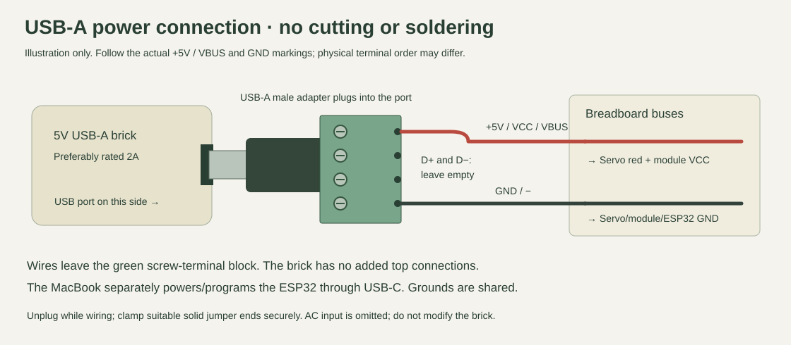
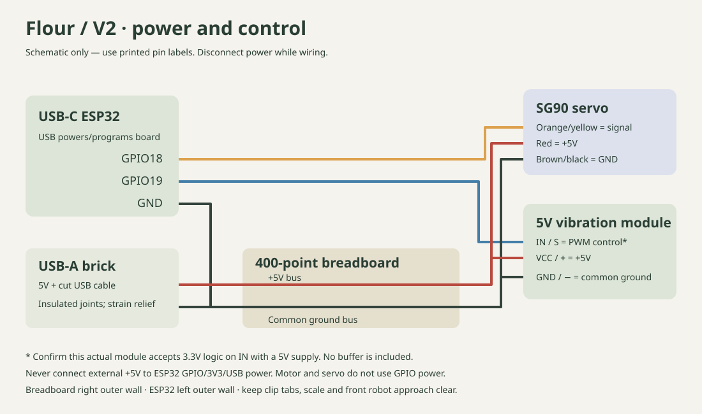

# Wiring — existing 5V PWM module and four-terminal USB-A adapter

Disconnect USB and external power while wiring. Match labels printed on your boards, not physical pin order in a drawing. The ESP32 mounts separately from the breadboard.

Your **MacBook USB-C powers/programs the ESP32**. Your **5V USB-A brick → USB-A male to four screw terminals → two jumper leads → breadboard** supplies the servo and motor. The adapter is the solderless type shown by the user; no cable cutting or splicing is needed. Use a regulated 5V brick, preferably rated 2A. Join ESP32 GND to the breadboard ground bus.

## Adapter connection and orientation

1. Unplug the brick. Insert two suitable solid jumper ends into the adapter terminals marked **+5V / VCC / VBUS** and **GND / −**. Tighten securely and tug-check; no exposed strands/metal may bridge terminals.
2. Connect +5V to the positive breadboard bus and GND to the ground bus. Leave **D+ and D− empty**. Do not infer order from the four positions in the model; read the real adapter's markings. Verify 5V output and polarity before attaching electronics, then unplug again to complete wiring.
3. Plug the adapter's metal USB-A end directly into the brick's USB-A socket. Support both beside the stand and relieve wire tension. In the animation, the brick lies on its side; its port faces the adapter, and the two leads leave the green terminal block at the **opposite end**. The brick itself has no added top wire connections. The AC input/plug is omitted from the model.

The listing's “300V / 8A” terminal rating does not describe USB output; the brick provides 5V. An adapter does not increase its available current. If terminal labels are absent, identify the connections by documentation/continuity rather than guessing. Never connect the power bus to D+ or D−. In particular, **D− is a data terminal, not ground**; use the terminal explicitly identified as GND.

The breadboard buses are the “power junction,” not another module. Keep the servo's existing socket and use jumper pins; do not cut the servo cable. See [Parts](PARTS.md) for the six female-to-male and five male-to-male leads used here.

| From | To |
|---|---|
| Adapter +5V / VCC / VBUS | Breadboard positive bus |
| Adapter GND / − | Breadboard ground bus |
| ESP32 GND | Same ground bus |
| Servo red | +5V bus |
| Servo brown/black | Ground bus |
| Servo orange/yellow | ESP32 GPIO18 |
| Vibration module VCC / + | +5V bus |
| Vibration module GND / − | Ground bus |
| Vibration module IN / S | GPIO19 **only after compatibility check** |
| ESP32 USB-C | Computer for flashing; USB power during use |

The external +5V bus does **not** connect to the ESP32 3V3 pin, any GPIO, or its USB/VIN supply. The two supply grounds must connect. Never power the motor or servo directly from a GPIO. This version uses the module's onboard driver.

## Breadboard details

On a typical 400-point board, each group of five terminal holes connects together; opposite sides of the center channel do not. Long edge rails are separate buses and may be split. Confirm continuity on the actual board with power disconnected. Label the +5V and ground buses. Bridge split sections only when necessary, with power disconnected, and recheck for a short before powering.

For signals, use a free five-hole group for each separate net: GPIO18 and servo signal in one group, GPIO19 and module IN in another. Do not join those groups to each other or to +5V. Male-to-female jumper leads connect male ESP32/module headers to the breadboard; male-to-male leads can connect the servo female socket to it. Secure leads so servo vibration cannot pull them out.

## Check the motor module before GPIO19 connection

1. Keep module IN disconnected from the ESP32. Verify the module's printed VCC/GND/IN labels.
2. Apply regulated 5V to VCC and GND. The specified 3.7V starting voltage concerns the motor supply, not the control signal.
3. Measure IN relative to GND. If it is near 5V, **do not connect it to a GPIO** until its input circuit is identified. A low reading alone does not prove compatibility. Confirm through the seller's input specification or inspection of the actual board's driver/input network that 3.3V is accepted and the ESP32 pin is not exposed to 5V.
4. With external power off, connect the verified IN to GPIO19 and join grounds. Upload the firmware first; it starts with motor PWM at zero.
5. After verification, tick the explicit motor checkbox in the setup page. Run a small supervised test, then press Stop. Leave vibration disabled if it runs with PWM zero, fails to start, or behaves erratically.

Research supports common modules accepting 3.3V logic; it does not prove the exact Amazon batch. If this module needs a driver/level adapter, that is a later hardware change. Do not substitute a bare 3V motor on GPIO19. Gate-only operation with `duty: 0` remains available.

## Mechanical wiring checks

Tape the breadboard back to the right outer side wall, and the ESP32 to the left outer side wall. Use insulating foam tape behind the ESP32. Keep USB-C facing toward the front. Keep USB-C accessible, the front approach clear and all wires outside the rotating gate. Mount the vibration module firmly on the hopper exterior with its solder joints insulated. Route slack outward and secure it to the frame; no dangling leads beneath the gate.

If the servo causes resets or jitter, stop and inspect supply rating, cable resistance, ground connections and breadboard contacts. Extra power filtering or a separate servo power distribution arrangement may be necessary after testing; the current design has no added capacitor.
