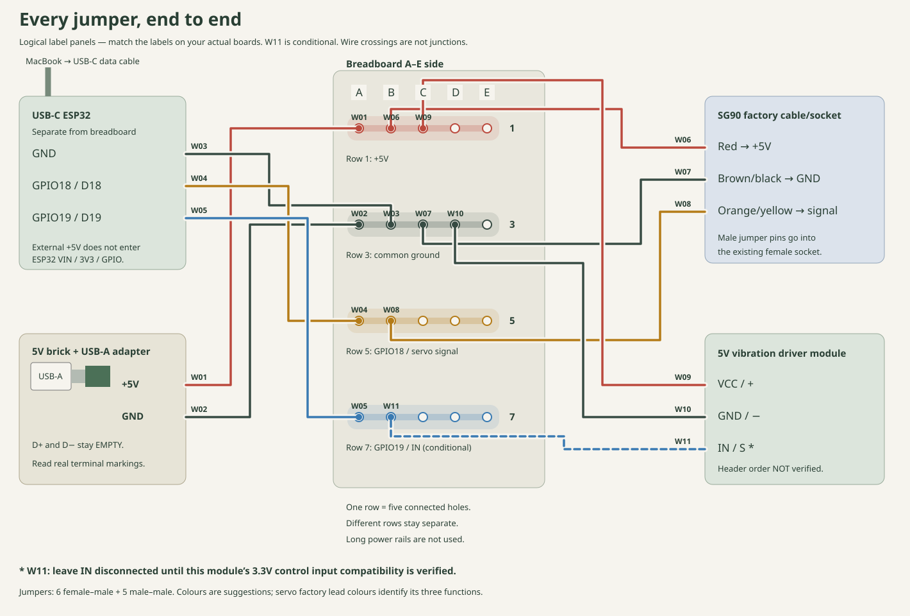
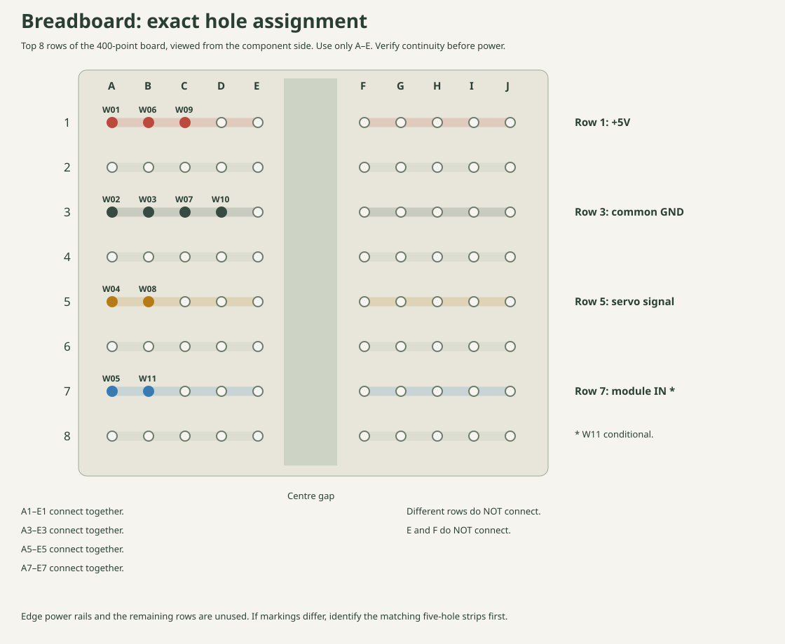

# Numbered end-to-end wiring plan

**[Open the interactive W01–W11 guide](https://dylanler.github.io/flour-dispenser-assembly/hardware/wiring/WIRING_GUIDE.html)**. Select each wire to see both ends, jumper type and exact breadboard hole. Use the numbered map for wiring; the 3D cable routes are illustrative.

Unplug computer USB and the external brick before inserting/moving jumpers. Match actual component labels, not schematic header positions. GPIO18/19 refer to labelled classic ESP32 GPIOs, not the eighteenth/nineteenth physical header pin. ESP32 mounts separately from the breadboard.

MacBook → USB-C data cable → ESP32 supplies/programs the board. Regulated 5V USB-A brick (preferably 2A) → four-terminal USB-A male adapter → W01/W02 → breadboard supplies the servo/module. Use +5V/VCC/VBUS and GND only. D+ and D− stay empty; D− is not ground. The adapter rating 300V/8A is not USB output. Plug its metal USB-A end into the brick's port, support it on the bench, and route the two leads from the green terminal block. No brick-case wires, cut cable or soldering.

## Four five-hole junctions; long rails unused

Use only the A–E side. Row 1 is +5V, row 3 common GND, row 5 servo signal, row 7 module IN. Each row's five holes join internally; different rows and the F–J side stay separate. The edge rails and other rows are unused; no bridges needed. Verify strip continuity unpowered. If markings differ, identify and label the equivalent five-hole groups first.

| ID | Component end | Breadboard hole | Jumper ends |
|---|---|---|---|
| W01 | USB-A adapter +5V / VCC / VBUS | A1 | M–M / solid ended |
| W02 | USB-A adapter GND / − | A3 | M–M / solid ended |
| W03 | ESP32 GND | B3 | F–M |
| W04 | ESP32 GPIO18 / IO18 / D18 | A5 | F–M |
| W05 | ESP32 GPIO19 / IO19 / D19 | A7 | F–M |
| W06 | SG90 red lead, female servo socket | B1 | M–M |
| W07 | SG90 brown / black lead, female servo socket | C3 | M–M |
| W08 | SG90 orange / yellow lead, female servo socket | B5 | M–M |
| W09 | Vibration module VCC / + | C1 | F–M |
| W10 | Vibration module GND / − | D3 | F–M |
| W11 | Vibration module IN / S / signal | B7 | F–M |

Six F–M and five M–M leads. F–M female sockets go on ESP32/module male headers; male ends go in the breadboard. Servo factory female socket cavities accept the three M–M jumper pins, identified by factory wire colour. Do not cut its cable. Secure the adapter's solid-ended leads so no exposed metal bridges terminals.

Complete paths: adapter +5V→W01→row 1→W06 servo red / W09 module VCC. Adapter GND→W02→row 3→W03 ESP32 GND / W07 servo ground / W10 module ground. GPIO18→W04→row 5→W08 servo signal. GPIO19→W05→row 7→W11 module IN, conditional on input verification. External +5V does not enter ESP32 VIN/5V, USB power, 3V3 or GPIO; its GND is joined through W03.

Check the supply first with W01/W02 only: verify about +5V from row 1 to row 3, then unplug before adding component leads. Leave module VCC (W09) unplugged and IN (W11) disconnected for initial servo-only testing; an undocumented IN may float. Apply module power separately for a supervised compatibility check, and add W09/W11 with both sources unplugged only after verification. A low IN voltage reading alone does not prove logic compatibility.

## Check the motor module before GPIO19 connection

1. Keep module IN disconnected from the ESP32. Verify the module's printed VCC/GND/IN labels.
2. Apply regulated 5V to VCC and GND. The specified 3.7V starting voltage concerns the motor supply, not the control signal.
3. Measure IN relative to GND. If it is near 5V, **do not connect it to a GPIO** until its input circuit is identified. A low reading alone does not prove compatibility. Confirm through the seller's input specification or inspection of the actual board's driver/input network that 3.3V is accepted and the ESP32 pin is not exposed to 5V.
4. With external power off, connect the verified IN to GPIO19 and join grounds. Upload the firmware first; it starts with motor PWM at zero.
5. After verification, tick the explicit motor checkbox in the setup page. Run a small supervised test, then press Stop. Leave vibration disabled if it runs with PWM zero, fails to start, or behaves erratically.

Research supports common modules accepting 3.3V logic; it does not prove the exact Amazon batch. If this module needs a driver/level adapter, that is a later hardware change. Do not substitute a bare 3V motor on GPIO19. Gate-only operation with `duty: 0` remains available.

## Mechanical wiring checks

Tape the breadboard back to the right outer side wall, and the ESP32 to the left outer side wall. Use insulating foam tape behind the ESP32. Keep USB-C facing toward the front. Keep USB-C accessible, the front approach clear and all wires outside the rotating gate. Mount the vibration module firmly on the hopper exterior with its solder joints insulated. Route slack outward and secure it to the frame; no dangling leads beneath the gate.

If the servo causes resets or jitter, stop and inspect supply rating, cable resistance, ground connections and breadboard contacts. Extra power filtering or a separate servo power distribution arrangement may be necessary after testing; the current design has no added capacitor.
